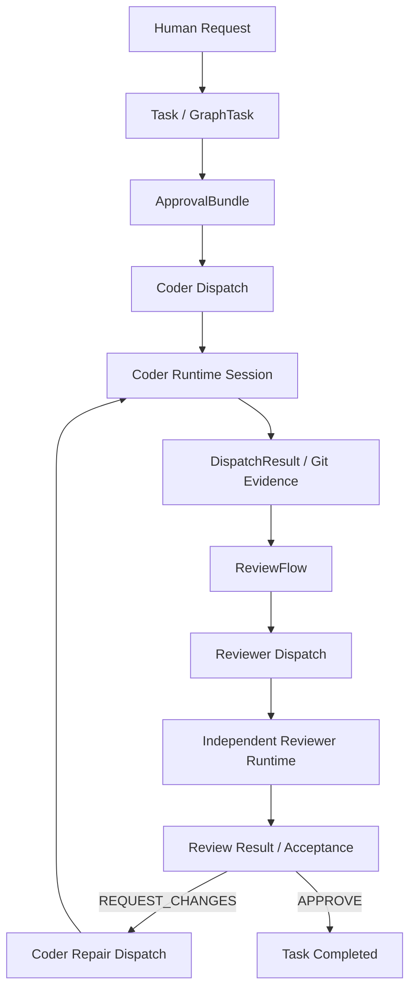
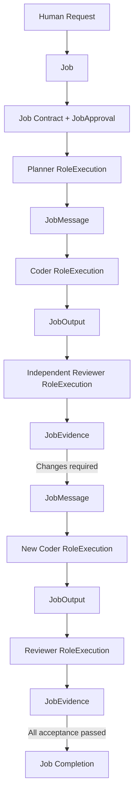

# 旧Task経路とJob経路の機能対応分析

Status: Derived from source at `f69c3b579aefa2c322f491cee102541459055598`  
Base: `c47c88d668effcd717d08ba2a3e1b5049d5417ea`  
Related: [ADR-0077](adr/0077-job-centered-role-collaboration.md), [Issue #283](https://github.com/hiono/taxion/issues/283), [Job execution implementation plan](job-execution-implementation-plan.md)

## 1. 目的と判定原則

本書は旧Task/Dispatch/ReviewFlow経路とJob/RoleExecution経路の対応を、印象や型名の類似ではなく、責務単位の割当問題として定義する。

比較の対象はデータ型だけではない。状態遷移、Controllerの操作、永続化、認可境界、成果物の出所、再開・復旧を含める。

**重要:** 現在の保存形式に旧経路と新経路の独立した二つのGraph型があるわけではない。両方のフィールドを持つ単一の `TaskGraph` が存在する。したがって、本書でいう旧グラフ・新グラフは論理モデルを指す。

判定は次の原則に従う。

1. 型やフィールドが存在するだけでは実装済みと判定しない。呼び出し可能な操作と検証規則が必要である。
2. 同じ名前・似た構造は対応の根拠にしない。責務・不変条件・ライフサイクルが一致する場合だけ対応付ける。
3. 認可、秘密情報、データ整合性、成果物の出所、二重実行防止は重み付けで妥協させず、ハード制約とする。
4. 新経路で実装されていない機能は、旧機能が存在することを理由に新経路で実装済みと扱わない。
5. 旧データの保全と旧実行プロトコルの継続を分離する。移行に必要な読み込みは残せるが、新規実行の権限源として旧モデルを再利用しない。

## 2. 数学的な割当モデル

### 2.1 責務を不可分な原子に分解する

旧経路の責務を原子集合 (R=\{r_1,\ldots,r_n\})、新経路の実装責務を候補集合 (C=\{c_1,\ldots,c_m\}) とする。

複数の新要素にまたがる責務は、割当の前に原子へ分割する。例として旧Dispatchの責務は、実行識別、Runtime binding、結果、検証、使用量に分ける。これにより一対一対応を強制せず、分割・統合を表現できる。

各原子 (r_i) は次のいずれか一つへ割り当てる。

- `REPLACE`: 新経路の責務が完全に代替する
- `SPLIT`: 複数の新要素へ分割して代替する（原子をさらに分割して個別割当）
- `MIGRATION_ONLY`: 旧データの読み込み・履歴表示だけに残す
- `RETIRE`: 目的上不要となり廃止する
- `GAP`: 代替がなく、新規実装が必要

### 2.2 変数と制約

(x_{ij}\in\{0,1\}) は責務原子 (r_i) を新要素 (c_j) に割り当てる変数とする。移行専用・廃止・未実装も候補列として持つ。

各原子は必ず一つの処置を持つ。

\[
\sum_{j\in C\cup\{MIGRATION,RETIRE,GAP\}}x_{ij}=1
\]

必須責務集合 (R_{must}) については、廃止・未実装への割当を禁止する。

\[
x_{i,RETIRE}=x_{i,GAP}=0
\quad (r_i\in R_{must})
\]

新要素への割当は、実装根拠がある組み合わせだけを許可する。責務と関係しない候補は (x_{ij}=0) とする。

### 2.3 最適化の優先順位

恣意的な重みでセキュリティ要件を相殺しないため、単一の加重和ではなく辞書式最適化を用いる。

1. ハード制約違反数をゼロにする。
2. 必須責務の未実装数をゼロにする。
3. 新経路に残す旧実行依存・二重権限源を最小化する。
4. 移行変更量と運用複雑度を最小化する。
5. 同等解が複数ある場合は、責務の境界が明確で、独立テスト可能な解を優先する。

この順序なら、低コストであることを理由に認可・整合性の要件を落とすことはできない。重み付けが必要な第4段階では、変更ファイル数ではなく、変更対象の責務数・移行対象データ数・追加状態遷移数を計測値として使う。

### 2.4 判定の証拠水準

- **FULL**: 型、操作、検証、永続化の根拠が揃う
- **PARTIAL**: 一部の責務は存在するが、経路・不変条件・運用操作が欠ける
- **NONE**: 新経路に代替実装が確認できない
- **MIGRATION**: 旧形式の読込み・変換に限定される

PARTIALをFULLに丸めない。実装根拠のない対応は候補から除外する。

## 3. 旧経路と新経路の論理グラフ

### 3.1 旧経路

旧経路の実行制御は `GraphDispatch` と `ReviewFlow` に分散する。ReviewFlowはDispatch列、修復回数、予算、期限、停止理由、復旧、引き継ぎ変更、フィードバック、Instruction Draft等を保持する。

### 3.2 新経路（設計目標）

これは目標グラフであり、現時点で全遷移がControllerに実装済みという意味ではない。

### 3.3 現在の実装経路

- `JobRoleController` は単一RoleExecutionの Start / Resume / Send / Wait / Events / operation authorization / usage recording / PostMessage / Finish / Stop を提供する。
- `AppendJobMessage` はJob上の追記履歴を保存する。メッセージの保存自体はRoleの実行権限を付与しない。
- `RoleExecution` は親実行・TriggerMessageID・JobID・TaskIDを保持できる。
- ただし、JobMessageを契機に宛先RoleExecutionを生成し、宛先の実行・回答・元実行の再開までを一貫して調停する動的Dispatcherは確認できない。
- よって、目標グラフのRole間往復は未完成であり、実モデルE2Eの成立を意味しない。

## 4. 責務原子と割当結果

| ID | 旧経路の責務原子 | 新経路候補 | 判定 | 根拠・不足 |
|---|---|---|---|---|
| R01 | 利用者依頼・目的・制約の継続単位 | Job | FULL | JobがTaskから独立した依頼・目的・制約・状態を保持 |
| R02 | 作業分割・Task依存関係・対象範囲 | GraphTask + Task.JobID + JobContract | FULL/PARTIAL | Task依存・親子関係はGraphTaskに残る。Job scopeとの包含検証あり。Plannerによる動的分割実行は別途未完成 |
| R03 | Taskの承認対象と実行契約 | JobContract + JobApproval | FULL（新権限モデル） | immutable proposal hash、record hash、scope・budget・deadline・configurationをJob単位で承認 |
| R04 | 旧Task ApprovalBundle | MIGRATION_ONLY | MIGRATION | 新Job authorityへ継承しない。新規Jobの認可判定に使用しない |
| R05 | Role/実行ごとの識別と状態 | RoleExecution + RoleExecutionHistory | FULL | JobID、TaskID、Role、親実行、状態遷移、Runtime bindingを保持 |
| R06 | Runtime session/configuration binding | RoleExecution + JobRoleController | FULL/PARTIAL | session ID/config hashを束縛し、開始・再開前に検証。Roleごとのworktree・tool policy結合の全体検証は別途必要 |
| R07 | Dispatch指示・Context生成 | JobExecutionContext + JobRoleController.Send | PARTIAL | Job Contextを再構成して送信するが、旧DispatchInstructionの全ての構造化出力・Git作業契約と同等とは確認できない |
| R08 | Coder成果物と不変参照 | JobOutput | PARTIAL | repository、kind、content hash、commit/tree/blob参照は保持。旧DispatchResultの変更一覧・validation詳細・worktree観測等を一対一では保持しない |
| R09 | Reviewerによる独立検証 | Reviewer RoleExecution + JobEvidence | PARTIAL | producerと異なる成功済みReviewer実行による検証を要求可能。レビュー結果の詳細表現・全旧受入れルールの移植は別途必要 |
| R10 | ReviewFlowの工程順序・修復回数 | Job + RoleExecution + Controller | NONE/PARTIAL | Job状態・Role状態はあるが、MaxRepairs/Repairs/StagePlan等を含む旧Flowの全制御責務を置換する新Dispatcherは未完成 |
| R11 | Role間の依頼・回答・部分成果 | JobMessage + PostMessage | PARTIAL | append-onlyの自然言語メッセージと送受信実行IDはある。宛先実行生成・元実行再開の自動調停が未実装 |
| R12 | 実行予算・期限・同時実行上限 | JobContract.Budget + JobUsage + Deadline | PARTIAL | Job単位の実行数・同時実行数・AIU・期限を管理。旧FlowのCoder/Reviewer別セッション数・dispatch数に対応する制限は同じ粒度ではない |
| R13 | 使用量の出所と重複排除 | JobUsage | FULL/PARTIAL | RoleExecutionとRuntime sessionに結び付け、usage record hashとaccounting identityを検証。旧Usageの全メトリクスを維持するかは運用要件で決定 |
| R14 | 停止・再開・復旧・実行状態不明の解決 | RoleExecution状態 + JobRoleController | PARTIAL | Waiting/Suspended/CancelRequestedとResume/Stopはある。旧FlowのRecovery/HandoffChanges/停止後のrecontract相当の全シナリオは未確認 |
| R15 | Jobの完了判定 | JobCompletionReady + JobEvidence + JobUsage | PARTIAL | acceptance・required evidence・未解決実行・usage accountingを検証。実際のController終端処理との統合は別途確認が必要 |
| R16 | 旧ReviewFlow/Dispatchの履歴保全 | TaskGraph旧フィールド | MIGRATION/LEGACY | 現行TaskGraphに旧配列が残る。新Jobの実行権限として利用しないことを明示する必要がある |

## 5. 最適化結果（現時点）

上記の責務原子を、必須のものは新モデルで完全にカバーする制約で評価した結果は次のとおり。

### 5.1 採用する対応

1. **Taskの作業責務は維持し、Jobを上位の継続・協調単位とする。** TaskをJobへ統合しない。Task.JobIDを唯一の所属参照とする。
2. **ApprovalBundleの新規権限発行を廃止し、JobContract + JobApprovalへ集約する。** 旧ApprovalBundleは既存workspaceの履歴・移行データとしてのみ扱う。
3. **Dispatchの実行責務をRoleExecutionへ分割する。** Runtime bindingはRoleExecution、Job成果はJobOutput、検証判断はJobEvidence、使用量はJobUsage、調停はControllerが所有する。
4. **ReviewFlowを新経路の恒久的な工程エンジンとして残さない。** ただし、ReviewFlowが担っていた予算・修復・停止・復旧の責務は消さず、Job/RoleExecution/Controllerの明示的な責務へ移す。
5. **JobMessageは通信記録として維持し、実行権限や自動ディスパッチと混同しない。** Dispatcherが完成するまでは、Role間往復を実装済みと判定しない。
6. **TaskGraphの物理的な集約形式は当面維持できるが、旧配列を新経路から参照しない境界を設ける。** 最終的な物理分離は機能対応とは別の最適化課題とする。

### 5.2 残る必須ギャップ

- JobMessage受信から宛先RoleExecution生成、回答保存、元RoleExecution再開までのController調停
- Reviewerの独立したContext/作業環境と、JobOutputからJobEvidenceまでの完全な受入れ経路
- ReviewFlowが持つ修復上限、Role別予算、deadline停止、handoff hold、recoveryのJobモデルへの再配置
- 旧DispatchResultが持つ検証コマンド・Git変更・worktree観測のうち、新しい成果物/証跡契約に必要な項目の定義
- JobCompletionReadyとJobの終端状態遷移の統合
- 旧ApprovalBundleを新規に作らず、既存データだけを読み取る移行境界

### 5.3 既に確認された契約違反候補

`internal/runtime/controller/intake.go` の `appendConfirmedIntakeApprovalCandidate` は、先に `appendConfirmedJobApproval` を実行した後、`ApprovalRequirement()` が `ApprovalBundleRequired` の場合に旧ApprovalBundleを新規作成する。

これは `job-execution-implementation-plan.md` の「新しいJob intakeはJobApprovalのみをJob-level authorityとする」「旧Task approval bundleを新規にauthorityとして生成・継承・変換しない」と矛盾する。

単純に旧処理を削除すると、旧Task中心の既存実行経路を壊す可能性がある。したがって、次の境界を先に実装する。

- Job intake: JobApprovalのみを生成する。
- Legacy Task intake/runtime: 旧protocolを使う既存workspaceに限定する。
- JobRoleController: JobApprovalのみで認可し、ApprovalBundleを参照しない。
- Migration: 既存ApprovalBundleは履歴として保持し、新JobApprovalへ変換しない。

新旧経路を同一Task intakeで曖昧に混在させない。入口で実行モデルを識別し、どちらの認可規則を適用するか固定する。

## 6. 同一シナリオによる経路比較

対象シナリオ: Plannerが計画し、Coderが実装し、Reviewerが独立検証し、修正要求時にCoderが再実行する。

| ステップ | 旧経路 | 新経路の実装状態 |
|---|---|---|
| 1. 依頼確定 | Task + ApprovalBundle | Job + JobContract + JobApproval。Job側の権限モデルは存在 |
| 2. Planner実行 | 固定されたPlanner Dispatchは旧経路の標準ではない | RoleExecution/Controllerの単体実行基盤は存在。自動生成・調停は未完成 |
| 3. Coder依頼 | Coder Dispatch | RoleExecutionを作成・開始する基盤は存在。Plannerからの動的起動は未完成 |
| 4. Coder成果 | DispatchResult / Git evidence | JobOutputを保存するモデルは存在。旧Result全体の置換は未完成 |
| 5. Reviewer実行 | ReviewFlowがReviewer Dispatchを発行 | Reviewer RoleExecutionの独立性を表現可能。自動起動・受入れ経路は未完成 |
| 6. 修正要求 | ReviewFlowがCoder successor Dispatchを発行 | JobMessageで依頼を記録可能。宛先実行生成と元実行再開の調停が未完成 |
| 7. 再Reviewer | 次のReviewFlow/Dispatch | RoleExecutionを再作成する実行ループが未完成 |
| 8. Job完了 | Taskの終端状態 | JobCompletionReadyの判定ロジックは存在。Controllerの完了遷移統合は未完成 |

**結論:** 新モデルはデータ構造と単一RoleExecutionの実行基盤を持つが、旧ReviewFlowが提供した一連の自動実行ループをまだ置き換えていない。旧ReviewFlowを削除する前に、上記の必須ギャップを埋める必要がある。

## 7. 次の実装順序（依存関係で固定）

比較の再開・拡張を無制限に続けず、次の依存順序に固定する。

1. **入口の権限分離:** Job intakeとLegacy Task intakeを識別し、Job intakeでApprovalBundleを新規生成しない。既存Legacy経路の回帰テストを維持する。
2. **Job completion契約:** JobCompletionReady、Job状態遷移、未解決RoleExecution、証跡・使用量の終端条件を統合する。
3. **成果物・Reviewer契約:** JobOutput/JobEvidenceに不足するGit/validation証拠を定義し、独立Reviewerが検証できる統合経路を実装する。
4. **Role Dispatcher:** JobMessageを起点にRoleExecutionを生成し、宛先Roleを実行し、回答後に同一Jobの元実行を再開する。
5. **ReviewFlow責務の移行:** repair limit、Role別budget、deadline、stop/recovery/handoffをJob/RoleExecution/Controllerへ移す。
6. **旧経路の退役:** 新経路の同一シナリオE2Eと移行テストが成立した後に限り、旧ReviewFlow/Dispatchの新規生成経路を削除する。旧workspace読込みは別途移行要件に従う。

各段階の受入れ条件が満たされれば次へ進む。比較を繰り返すのではなく、実装・テストの結果で判定を更新する。

## 8. 検証ゲート

- [ ] Job intakeがJobApprovalのみを作り、ApprovalBundleを新規生成しない。
- [ ] Legacy Task intakeは明示的なlegacy経路でのみ旧ApprovalBundleを利用する。
- [ ] JobRoleControllerの認可がJobApproval/JobContractに限定される。
- [ ] Role間の依頼が同一Jobの別RoleExecutionとして実行され、回答後に元実行が再開する。
- [ ] ReviewerはCoderと異なるRoleExecutionであり、成果物のproducer自身ではない。
- [ ] Reviewerの証跡がJobOutput/JobEvidenceとAcceptance criterionに結び付く。
- [ ] budget/deadline/repair/recovery/stopがJob全体とRoleExecutionの状態に一貫して反映される。
- [ ] JobCompletionReadyとJob terminal transitionが整合する。
- [ ] 既存workspaceの旧データが失われず、新しい認可へ暗黙変換されない。
- [ ] `go test ./...` と `go test -race ./...` が成功し、実モデルE2Eは別証拠として確認される。

## 9. 参照した実装

- `internal/core/graph.go`: TaskGraph、GraphTask、GraphDispatch、DispatchResult、旧Task/Dispatch状態
- `internal/core/approval_bundle.go`: ApprovalBundle、Task単位の承認契約
- `internal/core/reviewflow.go`: ReviewFlow、FlowBudget、FlowRecovery、修復・停止・引き継ぎ
- `internal/core/job.go`: Job、RoleExecution、状態遷移、Runtime binding
- `internal/core/job_approval.go`: JobContract、JobBudget、JobApproval、RoleExecution start/resume/operation gates
- `internal/core/job_artifact.go`: JobOutput、JobEvidence、provenance、completion readiness
- `internal/core/job_message.go`: JobMessage、append-only conversation
- `internal/core/job_usage.go`: JobUsage、usage provenance/accounting
- `internal/runtime/controller/job_execution.go`: JobRoleController lifecycle and operations
- `internal/runtime/controller/job_context.go`: RoleExecution context construction
- `internal/runtime/controller/job_collaboration.go`: Job message persistence/read
- `internal/runtime/controller/intake.go`: JobApprovalと旧ApprovalBundleの二重生成候補
- `docs/develop/job-execution-implementation-plan.md`: Phase 1A authority boundary and phase gates
